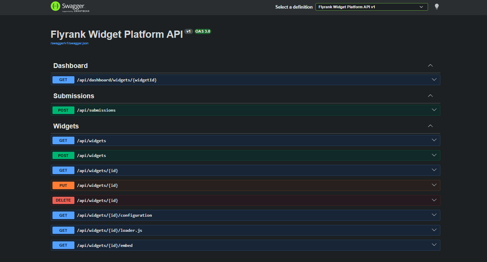
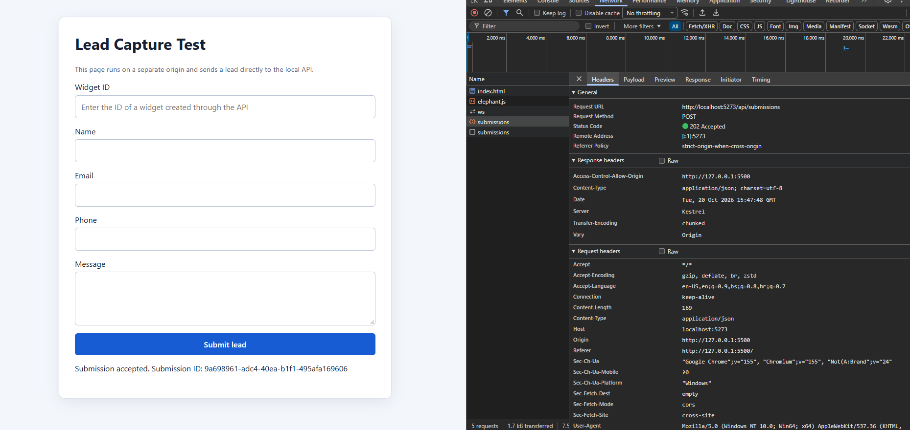
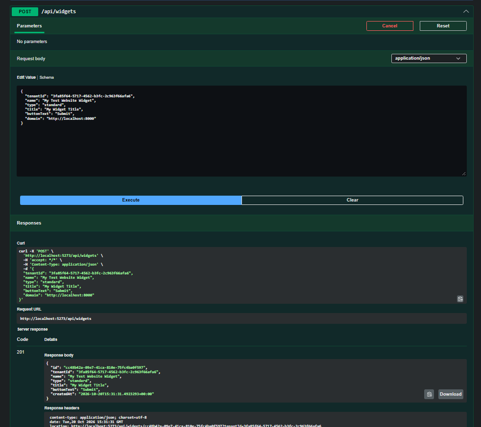
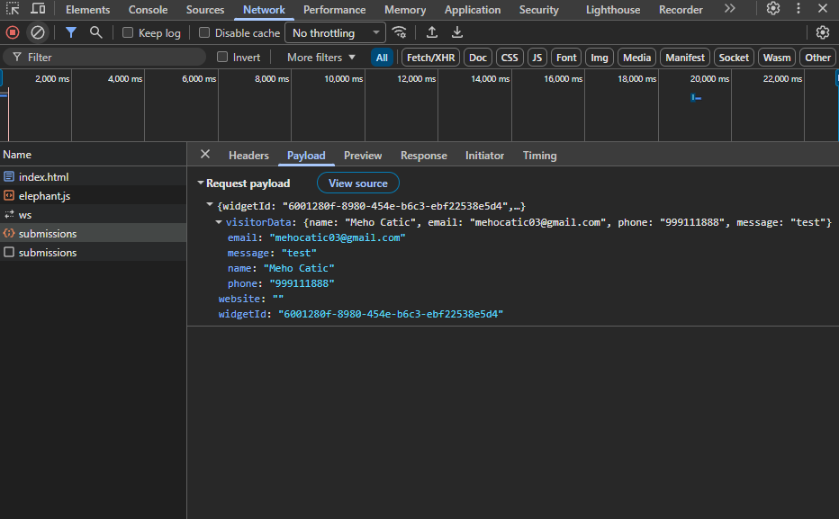

# Section 6 Evidence Map

This document maps the Section 6 behaviors requested for this capstone to the implementation and gives repeatable local checks. The repository currently has no automated test project. Captured screenshots below provide evidence of the Swagger endpoints, widget creation, and a successful cross-origin submission. The procedures below remain available for repeatable local checks.

Run the API using the `http` profile and create a widget before running submission checks. See [README.md](./README.md) for the API and second-origin test-site commands.

## Evidence by requirement

| Section 6 requirement | Implementation evidence | Verification |
| --- | --- | --- |
| CORS preflight from a second origin | `Program.cs` defines the `widget-embed` policy from `PublicSubmission:AllowedOrigins`; `SubmissionsController.Create` and the public configuration and loader actions opt into it. Development settings include `http://localhost:8000`. | Run the site on port 8000 and submit from it, or issue the preflight request below. Confirm the response includes `Access-Control-Allow-Origin: http://localhost:8000` and allows `POST` and `Content-Type`. |
| Invalid input returns 4xx | `[ApiController]`, required fields and validation attributes in `Services/WidgetContracts.cs`, and `Middleware/ApiExceptionHandler.cs` map invalid visitor data to HTTP 400. | Send the malformed body below and confirm `400 Bad Request`. |
| Burst submissions are rate limited with 429 | `Program.cs` configures a fixed-window limiter partitioned by remote IP, with default limit 10 requests per 60 seconds and no queue. `SubmissionsController.Create` enables the policy and the rejection handler returns HTTP 429. | After creating a widget, send more than 10 valid requests promptly from one client IP. Confirm a request after the configured limit receives `429 Too Many Requests`. |
| Honeypot spam is detected | `Services/SubmissionService.cs` marks non-empty `website` values as spam and skips geo enrichment for those submissions. The submission is accepted, and the dashboard reports spam separately. | Submit one request with `website` set to a non-empty string, then query the dashboard. Confirm the submission is present with `isSpam: true` and that the spam total increases. |
| Geo enrichment has a fallback | `Services/GeoEnrichmentService.cs` uses trusted proxy headers only for configured proxy IPs. Otherwise it optionally requests an external IP lookup for a valid, non-loopback IP. Missing/invalid configuration, loopback IPs, non-success responses, lookup request failures, invalid JSON, or timeout return no geo data. | With geo lookup disabled, submit from localhost and confirm the submission is still accepted with `geoData: null`. For the external lookup fallback path, configure a reachable HTTPS provider and test a non-loopback client address; provider availability is environment-dependent. |
| Safe side-effects | The submission service does not call geo enrichment for honeypot spam. Geo lookup uses a named `HttpClient` with a three-second timeout, restricts non-Development URLs to HTTPS, and logs lookup failures while returning no geo data. The widget store is in-memory and has no external persistence or messaging side effects. | Submit a honeypot request while geo lookup is configured and verify the submission succeeds and is classified as spam without requiring a lookup. Test geo provider failure and confirm a valid submission still receives `202 Accepted`. |

## Manual request examples

Use an existing widget ID in place of `{widgetId}`. Replace the tenant ID if you created the widget with a different one.

### CORS preflight

```powershell
curl.exe -i -X OPTIONS "http://localhost:5273/api/submissions" `
  -H "Origin: http://localhost:8000" `
  -H "Access-Control-Request-Method: POST" `
  -H "Access-Control-Request-Headers: content-type"
```

The API's development configuration allows this origin. An origin not listed in `PublicSubmission:AllowedOrigins` must not receive an `Access-Control-Allow-Origin` permission for itself.

### Validation failure

```powershell
curl.exe -i -X POST "http://localhost:5273/api/submissions" `
  -H "Content-Type: application/json" `
  --data-binary '{"widgetId":"00000000-0000-0000-0000-000000000000","visitorData":[],"website":""}'
```

`visitorData` must be a JSON object. This request should be rejected with `400 Bad Request` by model validation.

### Honeypot classification and dashboard confirmation

```powershell
$widgetId = "22222222-2222-4222-8222-222222222222"
$tenantId = "11111111-1111-4111-8111-111111111111"
$body = @{
  widgetId = $widgetId
  visitorData = @{ email = "spam-check@example.test" }
  website = "filled-by-automation"
} | ConvertTo-Json -Depth 5

Invoke-RestMethod `
  -Method Post `
  -Uri "http://localhost:5273/api/submissions" `
  -ContentType "application/json" `
  -Body $body

Invoke-RestMethod `
  -Method Get `
  -Uri "http://localhost:5273/api/dashboard/widgets/$widgetId`?tenantId=$tenantId" |
  ConvertTo-Json -Depth 8
```

Use IDs returned by your own widget creation request. The sample IDs above are placeholders and will not refer to a widget unless that ID is actually present in the running in-memory store.

### Rate-limit burst

The default limit is ten requests in a 60-second window per remote IP. Run the following after creating a widget. It emits each response status; expect HTTP 429 once the active window's allowance is exhausted. A new API process starts with an empty in-memory store and a fresh limiter state.

```powershell
$widgetId = "22222222-2222-4222-8222-222222222222"
$body = @{
  widgetId = $widgetId
  visitorData = @{ email = "burst-check@example.test" }
  website = ""
} | ConvertTo-Json -Depth 5

1..12 | ForEach-Object {
  curl.exe -sS -o NUL -w "%{http_code}`n" `
    -X POST "http://localhost:5273/api/submissions" `
    -H "Content-Type: application/json" `
    --data-binary $body
}
```

If a reverse proxy is used, the IP observed by the application can differ from the visitor IP. The current rate limiter partitions on the connection's remote IP and does not enable forwarded-header processing in `Program.cs`.

## Captured screenshots

### Swagger API endpoints



The Swagger UI loaded the API definition and displays the dashboard, submissions, and widget endpoints, including `POST /api/submissions`.

### Widget creation



The widget creation request completed successfully with HTTP `201 Created`, confirming that the platform can create and return widget data.

### Successful lead capture and CORS validation



The browser submitted a lead from origin `http://127.0.0.1:5500` to `POST /api/submissions`. The API returned HTTP `202 Accepted` and `Access-Control-Allow-Origin: http://127.0.0.1:5500`, confirming both successful lead capture and CORS permission for the Live Server origin.

### Lead capture request payload



The network panel shows the submitted visitor data and widget ID for the lead capture flow. Together with the accepted response and CORS header shown above, this confirms the widget platform submission path worked end to end.

## Limitations

- The screenshots show local manual checks. No CI run or external geo provider result is asserted here.
- The API stores widgets and submissions in process memory. Restarting the process removes them.
- Tenant scoping is not authentication. Management and dashboard endpoints need authenticated tenant identity before production use.
- Geo lookup depends on an externally configured provider and a public client IP; local loopback submissions intentionally do not perform the external lookup.
